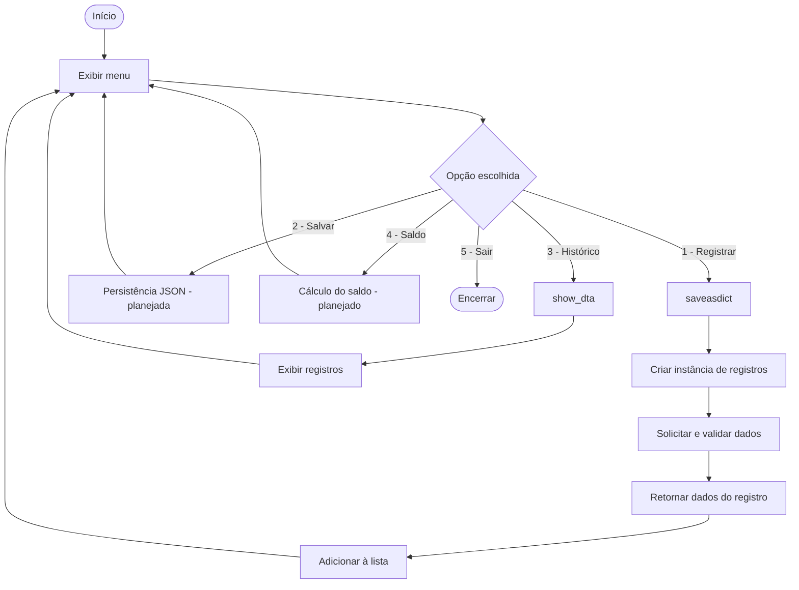

# Estudo Econômico em Python

Projeto de estudo desenvolvido em Python para praticar programação orientada a objetos, organização modular, validação de entradas e manipulação de registros financeiros.

A aplicação permite cadastrar movimentações financeiras, armazená-las temporariamente em uma estrutura de dados e consultar o histórico registrado durante a execução.

> **Status:** projeto em desenvolvimento. O foco atual está na estruturação dos registros e no fluxo de interação pelo terminal. Persistência em arquivo JSON e cálculo automático do saldo são próximas etapas.

## Objetivos de aprendizagem

- Aplicar programação orientada a objetos com classes e instâncias.
- Organizar o código em módulos com responsabilidades distintas.
- Trabalhar com métodos, atributos e retorno de dados.
- Validar entradas fornecidas pelo usuário.
- Manipular listas e dicionários para armazenar registros.
- Utilizar estruturas de decisão e repetição para controlar o fluxo da aplicação.

## Estrutura do projeto

```text
estudo_enocomico_py/
├── main_class.py   # Classe responsável pelos registros financeiros
├── functions.py    # Funções para cadastrar e exibir registros
└── menu.py         # Interface de interação pelo terminal
```

## 1. `main_class.py` — Modelagem dos registros

O módulo contém a classe `registros`, responsável por representar uma movimentação financeira.

Cada instância armazena os dados de um registro por meio dos atributos:

| Atributo | Finalidade |
|---|---|
| `name` | Nome ou identificação associada à movimentação |
| `value` | Valor financeiro informado |
| `type_mov` | Tipo de movimentação, como PIX, boleto, crédito, TED ou débito |
| `inadout` | Indicação de entrada ou saída |

A classe reúne métodos para solicitar e validar as informações:

- `insert_name()`: solicita o nome e verifica se a entrada contém caracteres alfabéticos e espaços.
- `insert_value()`: solicita o valor financeiro e converte a entrada para `float`.
- `insert_typemv()`: apresenta os tipos de movimentação aceitos e verifica a opção informada.
- `insert_inadouts()`: solicita a classificação da movimentação como entrada ou saída.
- `record()`: coordena o preenchimento dos atributos e retorna os dados da instância em formato de dicionário.

O `self` representa a instância atual. Assim, `self.__dict__` permite acessar os atributos daquela instância. Se o método retornar `self.__dict__.copy()`, será devolvida uma cópia superficial do dicionário, evitando que alterações nas chaves do dicionário retornado modifiquem diretamente o dicionário original da instância.

## 2. `functions.py` — Operações com os registros

Este módulo importa a classe `registros` e reúne funções que trabalham com uma lista de movimentações.

- `saveasdict(arr)`: cria instâncias de `registros`, conduz o preenchimento dos dados e adiciona os registros à lista recebida.
- `show_dta(arr)`: percorre a lista e apresenta os dados de cada movimentação, identificando cada item por sua posição no histórico.

A lista funciona como armazenamento temporário durante a execução do programa. Os registros são representados por dicionários, o que facilita percorrer e exibir seus campos.

## 3. `menu.py` — Interface e fluxo principal

O módulo apresenta um menu textual e direciona a execução de acordo com a opção selecionada.

| Opção | Ação |
|---|---|
| 1 | Registrar uma movimentação |
| 2 | Salvar os dados |
| 3 | Exibir o histórico |
| 4 | Calcular o saldo |
| 5 | Sair |

As opções de registro e consulta utilizam as funções importadas de `functions.py`. A persistência em JSON e o cálculo do saldo devem ser considerados funcionalidades pendentes enquanto não tiverem implementação concluída.

## Fluxo geral da aplicação



## Como executar

**Requisito:** Python 3.10 ou superior, devido ao uso de `match/case`.

Clone o repositório:

```bash
git clone https://github.com/dvd10082010-lgtm/estudo_enocomico_py.git
cd estudo_enocomico_py
```

Para iniciar a função de menu a partir do terminal:

```bash
python -c "from menu import menu; menu()"
```

Outra opção é adicionar ao final de `menu.py`:

```python
if __name__ == "__main__":
    menu()
```

Depois disso, a aplicação pode ser iniciada com:

```bash
python menu.py
```

## Conceitos praticados

| Conceito | Aplicação no projeto |
|---|---|
| Classes e objetos | Representação de cada movimentação pela classe `registros` |
| Atributos de instância | Armazenamento dos dados de cada registro |
| Métodos | Solicitação, validação e organização dos dados |
| Modularização | Separação entre modelagem, funções auxiliares e menu |
| Listas | Armazenamento temporário do histórico |
| Dicionários | Representação dos campos de cada movimentação |
| Laços de repetição | Solicitação de dados e exibição do histórico |
| Condicionais e `match/case` | Controle das opções e validação das escolhas |

## Próximas etapas

- Implementar a gravação e leitura dos registros em JSON.
- Implementar o cálculo do saldo, considerando entradas e saídas.
- Melhorar o tratamento de entradas inválidas e exceções.
- Adicionar testes para os métodos de validação e operações com os registros.
- Avaliar a separação entre a lógica de negócio e a interação com o terminal.

## Sobre o projeto

Este repositório faz parte dos meus estudos em programação e desenvolvimento de software. O projeto utiliza um problema de organização financeira como contexto para praticar fundamentos de Python e evoluir gradualmente a estrutura do código.

**Tecnologia:** Python  
**Categoria:** Projeto acadêmico / estudo independente  
**Status:** Em desenvolvimento
